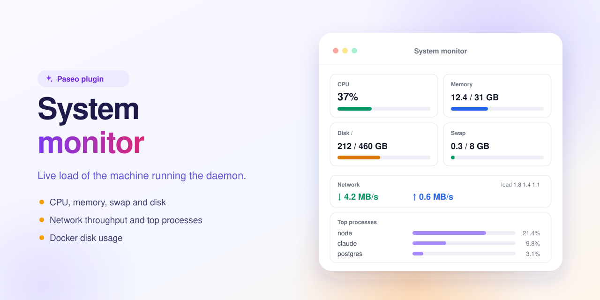

<p align="center"></p>

# System monitor — a Paseo plugin



Live CPU, memory, disk and network of the machine running the daemon.

Adds a **System monitor** sidebar screen showing CPU %, load average (1 / 5 / 15 min), memory and swap, disk usage of `/`, network throughput (↓ / ↑) and non-virtual interface addresses (Docker bridges and veths are hidden), top processes by CPU, and `docker system df` usage (cached, since it is slow on busy hosts). Network and swap readings use `/proc`, so they are Linux-only; other platforms show zeros.

## Install

Requires Paseo 0.8.0 or later; `docker` on the daemon for the Docker section.

```bash
paseo plugin install https://github.com/puchkoff/paseo-system-monitor
```

Or from a local clone: `paseo plugin install ./paseo-system-monitor`. Check with `paseo plugin ls`.

## Develop

```bash
npm install
npm run typecheck
```
